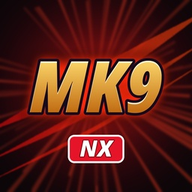

<div align=center>



</div>
<h1 align=center>mk9-nx installer</h1>

The installer page of [mk9-nx](https://github.com/Thorhax/mk9-nx), the native Nintendo Switch port of Mortal Kombat
Komplete Edition (Xbox 360): **https://thorhax.github.io/mk9-nx-installer/**

You give it your own copy of the game (its disc image, or a folder you extracted the disc into) and it gives you a zip
ready to extract into `sdmc:/switch/`. Everything runs in your browser: the game files never leave your computer.

## What it does

1. Finds the game in what you chose: a plain `.iso` of the disc (read in place, nothing is extracted to disk:
   `lib/xdvdfs.js`) or a folder with the extracted disc and its `default.xex`.
2. Identifies the game by the SHA-256 of `default.xex` (or of its decompressed image, for an executable another tool
   rebuilt) and picks its build from `release/manifest.json`.
3. Downloads that build's NRO and checks its SHA-256.
4. Makes the Switch renderer's shaders, `deko3d_glsl.bin`, from the game's own files. The build's recipe
   (`release/recipe-<version>.json`, written by `tools/installer_recipe_mk9.py` of mk9-nx from
   `shaders/tools/ue3_shader_locate.cpp`'s locations) says where each of the package's 19,010 shader containers is in
   your files: a slice of one of the LZO-compressed chunks of the game's Unreal packages (`Asset/*.xxx`, read with
   `lib/lzo.js`), or a slice of `default.xex`'s decompressed image. Two shaders Direct3D builds itself at run time are
   on no disc; the recipe carries them (468 bytes). Each container's size and SHA-1 are checked.
   The containers then go through Renut's translator (`wasm/renut_hlsl`, built from mk9-nx's
   `app/thirdparty/reblue-XenosRecomp` with `wasm/src/deko3d/build_wasm_deko3d.sh`), DXC, SPIRV-Cross
   (`wasm/spirv_cross`) and the deko3d GLSL passes (`lib/deko3d_glsl.js`). DXC, SPIRV-Cross and the passes run on
   several workers at once (`deko3d_worker.js`, one fewer than the computer's cores, at most 8): the 19,010 shaders
   take about 10 minutes with 7 workers (Chromium, 2026-10-27) and about 45 on one core. The package must match the
   SHA-256 of the build's `"deko3d"` entry.
5. Streams the zip to disk through the service worker, so a 7 GB package never has to fit in memory.

The zip holds `mk9-nx/mk9.nro` with its `LICENSES.txt`, the shaders (`deko3d_glsl.bin`) and the game files in
`mk9-nx/game_root/` (as on the disc, without `$SystemUpdate`). The update zip holds the NRO, its licenses and the
shaders. Neither holds `mk9.toml`: the game writes it at its first start, so an update never overwrites your settings.

The page and the downloaded program are cached by the service worker: after the first visit it also works without a
connection.

## Layout

| Path | Contents |
|---|---|
| `index.html`, `app.js` | The page and its interface (`lib/i18n.js`) |
| `worker.js` | Builds the package off the main thread; its pool of `deko3d_worker.js` compiles the shaders |
| `sw.js` | Offline cache and the download stream |
| `lib/` | Disc image reader, XEX reader, LZO and Unreal package chunks, shader recipe, deko3d package, zip writer |
| `wasm/` | WebAssembly builds of the shader translator, DXC, SPIRV-Cross and the LZX decoder |
| `renut_shader_common.h` | The translator's HLSL header (from mk9-nx's `app/thirdparty/reblue-XenosRecomp/XenosRecomp`) |
| `release/` | The list of builds, their shader recipes and the licenses of the NRO |
| `test/` | Node scripts that run the same code as the page |

`wasm/renut_hlsl.*` is built from the mk9-nx repository with `wasm/src/deko3d/build_wasm_deko3d.sh renut_hlsl`
(Emscripten 6.0.12; `USF4_NX` pointing at the mk9-nx checkout). `wasm/dxc_web.*` is the WebAssembly DXC of
[nfsmw-nx-installer](https://github.com/StevensND/nfsmw-nx-installer) (unmodified DXC v2025.1 with the
`dxc_web.cpp` wrapper); `wasm/spirv_cross.*` and `wasm/lzx.*` are usf4-nx-installer's. See [NOTICES.md](NOTICES.md).

## Deployment

The NRO is not stored here: it is the `mk9.nro` asset of a release of the mk9-nx repository of the same owner. The
workflow in `.github/workflows/deploy.yml` downloads it from the latest release, checks its SHA-256 against the list
and publishes the page on GitHub Pages. It runs on every push to `main`; after publishing a new release, run it by hand
from the Actions tab. Pages must be set to deploy from GitHub Actions (Settings > Pages > Source).

To publish a new build:

```sh
# in mk9-nx: where each container is, then the recipe
out/tools/ue3_shader_locate assets/game_root assets/game_root/Asset/*.xxx > out/ue3_locations.tsv
python3 tools/installer_recipe_mk9.py out/ue3_locations.tsv out/default_image.bin out/renut_shader_dump \
    out/deko3d_shaders/glsl_opt ../mk9-nx-installer/release/recipe-<version>.json
# here: the package from your copy with the page's code (the build's "deko3d" entry), and default.xex's hashes
node test/package_mk9_node.mjs <game folder> release/recipe-<version>.json <default.xex image> deko3d_glsl.bin
node test/xex_node.mjs <game folder>/default.xex
```

Test the release NRO with exactly that `deko3d_glsl.bin` beside it first (no DKSH cache, no pipeline list), then write
the build's entry of `release/manifest.json` (the script prints it as JSON):

```sh
node test/manifest_entry_node.mjs <game folder> release/recipe-<version>.json <default.xex image> <mk9.nro> \
    deko3d_glsl.bin <version>
```

## Testing locally

Put `mk9.nro` in `release/` and serve the folder (any static server works; this one sets the right MIME types):

```sh
python serve.py 8193
```

`node test/recipe_node.mjs <game folder> <recipe.json> <default.xex image>` rebuilds and checks every container.

## License

GPL-3.0 (`LICENSE`). Made from [usf4-nx-installer](https://github.com/Thorhax/usf4-nx-installer), itself made from
[sa2-nx-installer](https://github.com/ChanseyIsTheBest/sa2-nx-installer) by ChanseyIsTheBest, made from
[nfsmw-nx-installer](https://github.com/StevensND/nfsmw-nx-installer) by StevensND. Third-party parts:
[NOTICES.md](NOTICES.md). Mortal Kombat is a trademark of Warner Bros. Entertainment; this project is not affiliated
with or endorsed by Warner Bros. or NetherRealm Studios.
